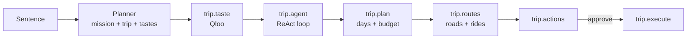

# Backline: architecture

Backline plans anything outside the home from one sentence. Qloo's taste graph sits at the centre: the person's taste is read first, and every search, score, map layer and plan decision afterwards uses it.

## 1. Layout

```
apps/web          Next.js 15 app: landing page, mission view, API routes
packages/engine   The agent, framework-free TypeScript with Zod at every boundary
packages/db       SQL migrations: accounts (profiles, trips, memories) in 0003; 0001–0002 are an earlier waitlist, no longer used
scripts/          API checks (keys, Qloo capabilities, location coverage)
```

The engine is a library. The web app is one client of it: an API route runs a mission and streams its events to the browser.

## 2. A planning mission, end to end



1. **Planner** (`missions.ts`). The model routes the sentence to a mission and extracts the trip: destination, dates, people, budget, needs, a landmark, a celebrity to plan like (`inspiredBy`) and the things they say they love (`likes`). Anything the user didn't say is dropped (`groundTrip`). Without a model, a keyword parser does the same job.
2. **Taste** (`skills/taste.ts`). See section 3.
3. **Agent** (`skills/trip-agent.ts`). A JSON ReAct loop (`agent/runtime.ts`) with tools: `update_trip`, `locate`, `search_places`, `check_places`, `research`, `read_document`. Limits: 8 turns, 18 calls, 90 seconds. If the model stalls, a scripted autopilot finishes the job, and a final pass makes sure everything the user needs was found. Hotels are sorted into four lanes (premium, closest, best value, lowest price) with prices only where one is really listed.
4. **Plan** (`skills/trip.ts`). The model writes the days, budget and tips from the agent's picks, using short ids that are mapped back, so it can't invent places. A template plan covers model failures.
5. **Routes** (`skills/trip-routes.ts`). Each day's stops are routed on real roads (OSRM), with ride fares between stops and the round trip from the user's home city.
6. **Actions and execute.** Hotel booking and payment through LiteAPI (live rates, prebook, book), reservation emails, calls and a calendar file, approved by the user first (or straight through in "Just do it"). Payment happens only at the approved price and within budget; card details never pass through Backline.

The orchestrator (`orchestrator.ts`) runs skills as a dependency graph: each starts when its inputs are ready, failures skip only what depends on them, and a checkpoint can pause the run until the user approves.

## 3. Qloo at the centre

| Step | Qloo call | What it gives the plan |
|---|---|---|
| Read the taste | `/search`, `/v2/tags` | Each thing they love becomes an entity (an artist, film, place) or a tag (a genre, a cuisine). A lower-case genre with an exact tag ("jazz") is read as the tag. |
| Themes | `/v2/insights` with `filter.type=urn:tag` and `filter.tag.types` | The vibe, the scenes and the dishes that go with the taste, and the price level it leans to |
| Audience | `urn:demographics` | The age group that shares the taste |
| Also loved | `urn:entity:artist`, `urn:entity:brand` | Cross-domain picks: what fans of this taste also love |
| Where it lives | `urn:heatmap` with `filter.location.query` | The heatmap for the city. The densest cluster of strong points becomes the taste zone, named with a reverse geocode. Without a landmark, searches centre there. |
| Places | `urn:entity:place` with the taste signals, a point and radius, and place tags | Hotels, restaurants, venues and things to do, ranked by affinity |
| Match | Affinity rank | Qloo's affinities sit close together, so each result's rank becomes a taste match from 0.5 to 1, used in scoring and shown on every card |

Qloo results are merged with OpenStreetMap places (the same name within 300 m is the same place), so contact details from the map join Qloo's ratings and taste data.

## 4. External services

| Service | Used for | Without it |
|---|---|---|
| Qloo (hackathon API) | Everything taste: section 3 | Required |
| Nebius Token Factory (NVIDIA Nemotron) | Planner, agent turns, plan writing | Keyword planner, autopilot and template plan |
| Claude API web search | Live research and listed hotel prices (a price is accepted only when its page is among the search results) | Tavily, then Wikivoyage and Wikipedia |
| OpenStreetMap: Nominatim, Photon, Overpass, OSRM | Geocoding, nearby places, area names, road routes | Straight-line estimates |
| Resend, Vapi | Emails and calls the user approved | The user sends or calls themselves |

Every client has timeouts, retries where safe, caching and a fixed time budget per call, so one slow service can't hold up a plan.

## 5. Web app

- `POST /api/mission` validates the request, rate-limits by IP, runs the mission and streams its events (server-sent events).
- `/api/mission/ask` answers follow-up questions from a mission's findings.
- `/api/documents` reads attached files (PDF, images, spreadsheets, Word) into text.
- `/api/transcribe` turns the voice prompt into text.
- `/mission` renders the stream as it lands: the taste card, the agent's activity, the plan with its map (routes, the taste heatmap and the zone), hotel lanes, places and the approval step.
- Exports run in the browser: calendar (.ics), PDF, Word document, PowerPoint (.pptx, built without dependencies) and web slides.

## 6. Safety

- User input, documents, web pages and model output are data. They're validated with Zod and never executed. Web text is quoted to the model as untrusted.
- Contacts found on the web are kept only if they appear in the cited source.
- Hotel prices are shown only when listed online, with the page linked. Nothing is estimated.
- Qloo responses are cached in memory only and never committed. Tests use synthetic data.
- See [`SECURITY.md`](../SECURITY.md).

## 7. Tests

`npm test` runs the engine's unit tests with stubbed clients (no network). `npm run typecheck` checks every workspace. `npm run check` verifies the API keys and Qloo's capabilities against the live API.

## Accounts and memory

Sign-in is Supabase Auth over its REST API (no client library): Google through `/auth/v1/authorize`, or a one-tap email link through `/auth/v1/otp`. Both return to `/auth/callback`, which posts the tokens to `/api/auth/session`; the server verifies them and stores them in `httpOnly` cookies, refreshing when they expire (`lib/session.ts`).

Account data lives in three tables (`0003_accounts.sql`), all behind row-level security and always reached with the person's own token:

| Table | Holds |
|---|---|
| `profiles` | Traveller details used for bookings (name, contact, date of birth, home city, currency, tastes) |
| `trips` | A compact record of each finished trip: bookings with references, days, budget |
| `memories` | What the agent learned: tastes named, cities visited, hotels stayed at |
| `searches` | Search history: every request, with its mode, title and destination (`0004_searches.sql`) |

When a signed-in person starts a mission, `/api/mission` merges their saved details with anything newer in the browser and their memories (`mergeProfile`): remembered tastes join the likes Qloo reads, and past stays become notes for the planner. As soon as a request is planned it goes into their search history, and any tastes it names are remembered straight away (`saveSearch`, `rememberTastes`). When a trip finishes, it is saved with what to remember from it (`tripRecord`, `memoriesFrom`).
